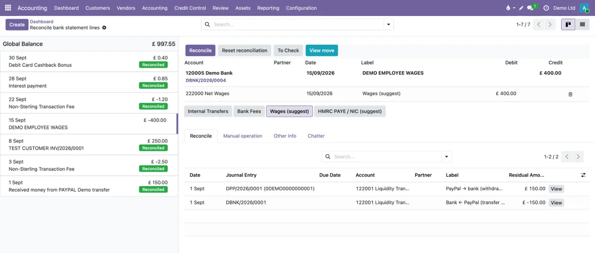
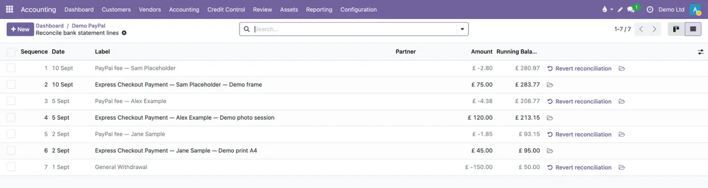

# UK bank statement import and matching for Odoo 19 Community

Four Odoo 19 Community modules that make bank and PayPal statements of a UK small business
import cleanly and reconcile mostly by themselves. Built on the
[OCA bank-statement-import](https://github.com/OCA/bank-statement-import) and
[OCA account-reconcile](https://github.com/OCA/account-reconcile) modules.

| Module | What it does |
|---|---|
| [`pt_statement_import_paypal_csv`](pt_statement_import_paypal_csv) | Imports the PayPal *Activity download* CSV: one line per payment at gross amount plus a separate PayPal fee line; authorisation holds (Memo) skipped; balances taken from the file. |
| [`pt_statement_import_sheet_order`](pt_statement_import_sheet_order) | Correct opening balance for statements exported newest first without a time of day (HSBC UK, Revolut Business). |
| [`pt_bank_ref_match`](pt_bank_ref_match) | Matches a bank line to an open invoice or bill by a reference found anywhere in the bank description (`INV/2026/0042`, `S01234`…); without a reference — by payer name and exact amount (suggest or automatic). |
| [`pt_uk_setup`](pt_uk_setup) | UK starter set: import mappings for HSBC UK, Wise and Revolut Business CSV, generic reconciliation rules (bank and PayPal fees, interest and cashback, PayPal ↔ bank transfers, card holds, wages and HMRC as suggestions), VAT-inclusive purchase tax. |

## Screenshots
Invented demo data (company «Demo Ltd»).

**Bank reconciliation** — fees, transfers, interest and cashback reconciled by rules, the customer payment matched to its invoice by reference, wages suggested:



**PayPal import** — gross amount and PayPal fee on separate lines, running balance in the file's order:



## Requirements
- Odoo 19.0 Community, UK chart of accounts (`l10n_uk`).
- OCA modules: `account_statement_import_file`, `account_statement_import_sheet_file`, `account_reconcile_oca` (and their dependencies).

## Try it
`examples/` contains two statements with invented data only:
- `hsbc_demo.csv` — import into a bank journal with the mapping *HSBC UK — Business Internet Banking (CSV)*; opening £1,000.00 → closing £997.55.
- `paypal_demo.csv` — import into a GBP PayPal journal **without** a sheet mapping; opening £200.00 → closing £280.97, the hold line is skipped.

## Licence
AGPL-3.0-or-later, see [LICENSE](LICENSE) and [COPYRIGHT](COPYRIGHT).

## Who we are
[ProTech Labs](https://www.protechlabs.co.uk) — the software side of Pro Technologies Limited, London.
Case study: [Move to Odoo Community](https://www.protechlabs.co.uk/case-studies/move-to-odoo-community).
Implementation and support: written brief, fixed quote.

## Tests

Each module has Odoo tests in `tests/` (synthetic data only). Run them on a throwaway
database with Odoo 19 Community and the OCA dependencies on the addons path:

```
odoo-bin -d test_db -i pt_bank_ref_match,pt_statement_import_paypal_csv,pt_statement_import_sheet_order,pt_uk_setup \
  --test-enable --test-tags /pt_bank_ref_match,/pt_statement_import_paypal_csv,/pt_statement_import_sheet_order,/pt_uk_setup \
  --stop-after-init
```
